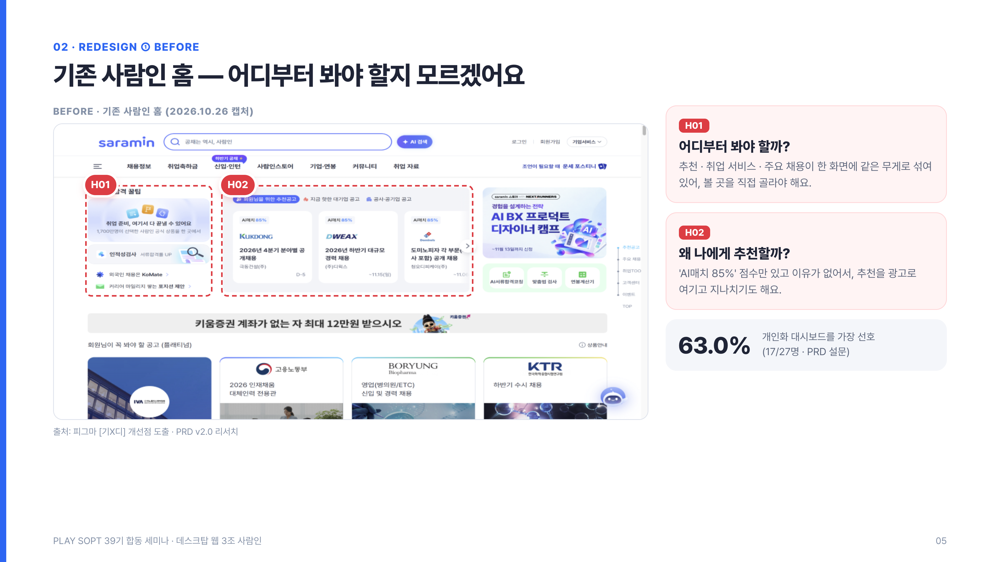
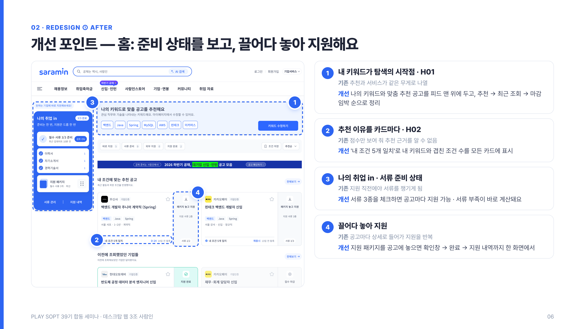
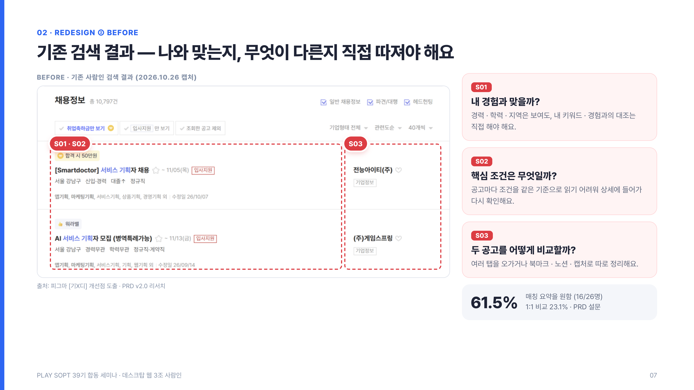
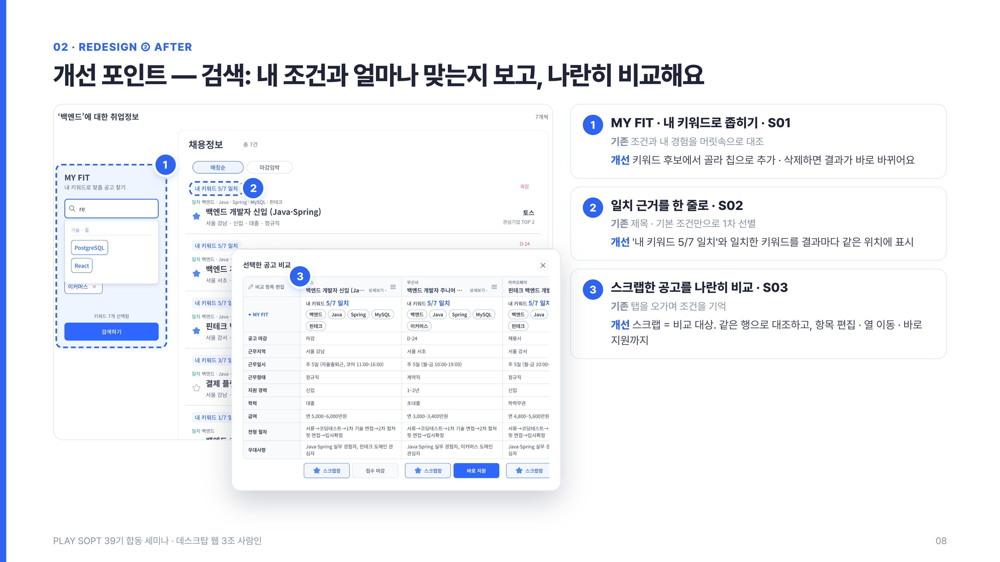
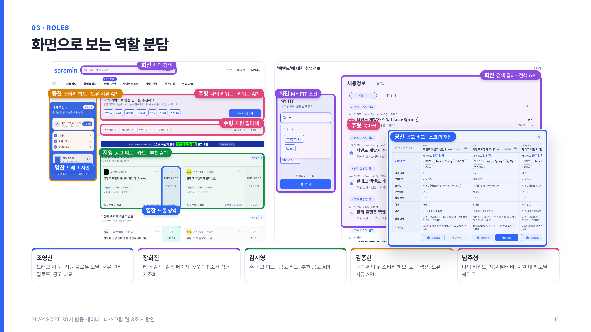

# PLAY SOPT 39기 합동 세미나 데스크탑 웹 3조 사람인

> **공고를 찾고, 비교하고, 끌어다 놓아 지원하는 사람인 리디자인**

<br />

## 📌 프로젝트 소개

취업 플랫폼 **사람인**의 홈과 검색 결과 화면을, 기획 · 디자인 파트와 함께 만든 리디자인안으로 구현한 프로젝트예요.<br />
기존 사람인은 추천 · 서비스 · 채용 정보가 한 화면에 섞여 있어 **어디부터 봐야 할지**, 추천된 공고가 **나와 왜 맞는지**, 여러 공고를 **어떻게 비교할지**를 사용자가 직접 따져야 했어요.<br />
그래서 **"지원 준비 → 탐색 → 비교 → 지원"** 을 화면 이동 없이 한 흐름으로 잇는 데 집중했어요.

🔗 **배포** : [39-collaboration-web-saramin.vercel.app](https://39-collaboration-web-saramin.vercel.app)

<br />

## ✨ 주요 기능

### 🏠 홈 — 준비 상태를 보고, 끌어다 놓아 지원해요





| 기능 | 설명 |
| --- | --- |
| **나의 취업 in** | 이력서 · 자기소개서 · 경력기술서 준비 상태를 체크하면 공고마다 지원 가능 여부가 바로 바뀌어요. 스크롤해도 공고 피드 안에서 따라와요. |
| **드래그 앤 드롭 지원** | 지원 패키지를 공고 카드에 끌어다 놓으면 지원 확인 → 제출 → 완료 → 지원 내역까지 한 화면에서 이어져요. |
| **나의 키워드 · 맞춤 추천** | 내 키워드를 피드 맨 위에 두고, 추천 공고 → 최근 조회 기업 → 마감 임박(48시간) 순으로 보여 줘요. |
| **추천 근거 · 지원 상태** | 카드마다 `내 조건 n개 일치`와 지원 가능 · 서류 부족 · 지원 완료 · 마감 상태를 보여 줘요. |
| **지원 필터 · 전체보기** | 지원 상태별 개수로 공고를 걸러 보고, 전체보기로 홈 안에서 목록을 펼쳐요. |
| **서류 관리 · 지원 내역** | 서류 목록 · 업로드(형식 · 용량 오류 포함)와 지원 내역 · 상세를 모달로 확인해요. |

### 🔍 검색 — 내 조건과 얼마나 맞는지 보고, 나란히 비교해요





| 기능 | 설명 |
| --- | --- |
| **MY FIT** | 키워드 후보에서 골라 칩으로 추가 · 삭제하면 결과가 바로 바뀌어요. |
| **일치 근거** | 결과마다 `내 키워드 5/7 일치`와 일치한 키워드를 보여 주고, 매칭순 · 마감임박순으로 정렬해요. |
| **헤더 검색 추천** | 검색창에 최근 검색어 · 자동완성 · 연관 검색어를 띄우고, 페이지 번호는 주소에 남겨 새로고침 · 뒤로가기에도 유지돼요. |
| **스크랩** | 홈 · 검색 · 비교 화면의 별표가 함께 바뀌고, 새로고침 · 다른 탭에서도 유지돼요. |
| **공고 비교** | 스크랩한 공고가 곧 비교 대상이에요. 같은 행으로 조건을 대조하고, 비교 항목 편집 · 열 순서 이동 · 바로 지원까지 할 수 있어요. |

### 🔌 서버 API와 목데이터

| 구분 | 기능 |
| --- | --- |
| **서버 API (7)** | 추천 · 조회한 공고 · 마감 임박 목록, 보유 서류 조회 · 변경, 내 키워드 조회, 공고 검색 |
| **목데이터** | 서버 범위 밖인 지원 제출 · 지원 내역 · 서류 업로드 · 비교 상세 항목은 목데이터로 끝까지 동작하게 만들었어요. |

<br />
## 👥 Team

|  |  |  |  |  |
| :---: | :---: | :---: | :---: | :---: |
| **조영찬** | **장희진** | **김지영** | **김종현** | **남주형** |
| [@ychany](https://github.com/ychany) | [@huijeanjang](https://github.com/huijeanjang) | [@2516391](https://github.com/2516391) | [@KimJongHyun2](https://github.com/KimJongHyun2) | [@Juhyung03](https://github.com/Juhyung03) |

<br />

## 🧑‍💻 역할 분담



| 이름 | 초기 세팅 | 공통 컴포넌트 | 페이지 · API |
| :---: | --- | --- | --- |
| **조영찬** | 프로젝트 생성 · 폴더 구조, 스타일 토큰, CI/CD · 배포, API 초기 세팅 | 모달 공통 컴포넌트, 헤더 · 푸터 | 드래그 지원 흐름, 서류 관리 · 업로드, 공고 비교 모달, 스크랩 저장, 조회한 공고 · 마감 임박 API |
| **장희진** | SVG 아이콘(SVGR), Discord PR 알림 | 검색 컴포넌트, 목록 · 행 컴포넌트 | 헤더 검색, 검색 페이지 연결, 공고 검색 API, MY FIT 조건 적용 · 재조회 |
| **김지영** | PR · 이슈 템플릿, 라벨, 오토 리뷰어 | 공고 카드, 지원 패키지 카드, 검색 결과 · 피드백 상태 | 홈 공고 피드 섹션, 추천 공고 API |
| **김종현** | 라우터, axios · TanStack Query, Storybook | 스티키 허브, 스켈레톤, 드롭 영역, 취업 준비 도구 | 홈 스티키 레일 · 도구 섹션, 보유 서류 조회 · 변경 API |
| **남주형** | ESLint · Prettier, 절대경로 | 버튼 · 칩 · 뱃지 · 태그 · 아이콘 | 나의 키워드 패널, 지원 필터 바, 지원 내역 모달, MY FIT 키워드 API, 북마크 |

### 🤝 함께 일한 방식

이슈 생성(템플릿 · 라벨 · 담당자) → `타입/이슈번호/기능명` 브랜치 → PR(CI 검사 · Vercel 미리보기 · Discord 알림) → 오토 리뷰어 코드 리뷰 → `dev` 머지 → `main` 릴리즈 · 자동 배포

<br />

## 🚀 Tech Stack

| 분류 | 기술 |
| --- | --- |
| UI · Language | React 19, TypeScript |
| Build · Package Manager | Vite, pnpm |
| Routing · Server State | React Router, TanStack Query, axios |
| Styling | Tailwind CSS v4, clsx + tailwind-merge (`cn`) |
| SVG · UI 문서화 | SVGR, Storybook |
| Lint · Format | ESLint, Prettier |
| CI/CD · Deploy | GitHub Actions, Vercel |
| Cooperation | GitHub, Notion, Discord, Figma |

<br />

## 🏁 Getting Started

```bash
nvm use          # Node 26 (.nvmrc)
corepack enable  # pnpm 12 (package.json packageManager)
pnpm install
pnpm dev
```

| Command | Description |
| --- | --- |
| `pnpm dev` | 개발 서버 실행 |
| `pnpm build` | 타입 검사 + 프로덕션 빌드 |
| `pnpm preview` | 빌드 결과 미리보기 |
| `pnpm lint` / `pnpm lint:fix` | ESLint 검사 / 자동 수정 |
| `pnpm format` / `pnpm format:check` | Prettier 적용 / 검사 |
| `pnpm storybook` | Storybook 실행 |

<br />

## 📁 Folder Structure

```
src
├── app
│   ├── layout          # 공통 레이아웃 (Header, Footer)
│   ├── App.tsx
│   └── main.tsx
├── pages
│   └── [page-name]
│       ├── api         # 페이지 전용 API 함수 · 쿼리 훅
│       ├── components  # 페이지 전용 컴포넌트
│       ├── constants
│       ├── hooks
│       ├── types
│       ├── utils
│       └── [page-name]-page.tsx
├── routes
│   └── router.tsx
└── shared
    ├── api/config      # axios 인스턴스, queryClient
    ├── assets/icons
    ├── components      # 공통 컴포넌트 (컴포넌트별 폴더)
    ├── constants
    ├── hooks
    ├── styles          # global.css, theme.css (디자인 토큰)
    ├── types
    └── utils           # cn 등
```

> 한 페이지에서만 쓰면 `pages/페이지명/` 안에, 두 페이지 이상에서 쓰면 `shared/`로 올려요.

<br />

## 📜 Convention

<details>
<summary><b>📂 폴더 · 파일명</b></summary>
<br />

- 폴더명과 파일명은 **kebab-case**를 사용해요. (`shared/components/search-bar/search-bar.tsx`, `use-recruit-list.ts`)
- 컴포넌트 이름은 **PascalCase**, 그 외 변수 · 함수는 **camelCase**를 사용해요.
- 폴더명은 가능하면 복수형을 사용해요. (`components`, `hooks`, `utils`)

</details>

<details>
<summary><b>🧩 컴포넌트</b></summary>
<br />

- 화살표 함수로 선언하고 `default export`를 사용해요.
- 한 파일에는 한 컴포넌트만 둬요.
- 의미 없는 `div`는 지양하고 시맨틱 태그(`section`, `header`, `main`, `nav`, `article`, `footer`)를 우선 사용해요.
- 최상단 래퍼가 의미가 없으면 Fragment(`<>...</>`)를 사용해요.
- children이 없는 컴포넌트는 self-closing으로 써요. (`<EmptyState />`)
- `button`에는 `type`을 꼭 명시해요.

```tsx
import type { ComponentProps, KeyboardEvent } from 'react';

import { cn } from '@/shared/utils/cn';

interface SearchBarProps extends ComponentProps<'input'> {
  onSearch: (keyword: string) => void;
}

const SearchBar = ({ onSearch, className, ...props }: SearchBarProps) => {
  const handleKeyDown = (e: KeyboardEvent<HTMLInputElement>) => {
    if (e.key === 'Enter') onSearch(e.currentTarget.value);
  };

  return (
    <input
      className={cn('h-12 rounded-lg border px-4', className)}
      onKeyDown={handleKeyDown}
      {...props}
    />
  );
};

export default SearchBar;
```

</details>

<details>
<summary><b>💡 변수 · 함수 · 훅</b></summary>
<br />

- 상수는 `UPPER_SNAKE_CASE`를 사용해요. (`MAX_PAGE_SIZE`)
- boolean은 `is` · `has` · `can` 접두어를 붙여요. (`isOpen`, `hasError`)
- 배열 등 복수 데이터는 `s`를 붙여요. (`recruits`)
- 줄임말보다 의미가 분명한 이름을 사용해요. (`btn` ❌ → `button` ⭕)
- 매직 넘버는 상수로 분리해요.
- 함수는 화살표 함수를 사용하고, 이름은 **동사 + 명사**로 써요.

| 접두어 | 의미 | 예시 |
| --- | --- | --- |
| `get` | 값을 조회해서 반환 | `getRecruitList` |
| `create` | 새 값을 생성 | `createQueryString` |
| `check` | 조건 검사 | `checkDeadline` |
| `convert` | 형태 변환 | `convertDateFormat` |
| `filter` | 필터링 결과 반환 | `filterByRegion` |
| `is` | boolean 반환 | `isExpired` |

- 이벤트 핸들러는 `handle`, Props로 넘길 때는 `on` 접두어를 사용해요. (`handleClick` → `onClick`)
- 커스텀 훅은 `use` 접두어를 사용하고 `named export`해요. (`useRecruitList`)
- 유틸 · 상수도 `named export`해요.

</details>

<details>
<summary><b>⛓️ 타입</b></summary>
<br />

- 타입 · 인터페이스는 PascalCase를 사용해요.
- `type`보다 `interface`를 우선 사용하고, 유니온 · 튜플 · 리터럴 타입이 필요할 때만 `type`을 써요.
- Props 타입은 반드시 `~Props` 접미사를 붙여요. (`SearchBarProps`)
- 컴포넌트 관련 타입은 같은 폴더에 두고, 커지면 `types.ts`로 분리해요.
- `any`는 금지예요. 불가피하면 `unknown`을 쓰고 좁혀서 사용해요.
- 타입만 가져올 때는 `import type`을 써요.

</details>

<details>
<summary><b>🎨 스타일 (Tailwind CSS)</b></summary>
<br />

- 디자인 토큰은 `shared/styles/theme.css`에 등록돼 있어요. 임의 값(`text-[#333]`)은 지양해요.
- Tailwind 기본 색상 · 글자 크기는 막혀 있어요. 피그마 토큰 이름을 그대로 사용해요.

| 종류 | 예시 |
| --- | --- |
| 색상 (Primitive) | `bg-blue-90`, `text-gray-110` |
| 색상 (Semantic, 우선 사용) | `bg-action-primary`, `text-text-secondary`, `border-border-default` |
| 타이포 (크기 · 행간 · 자간 · 굵기) | `text-heading-28`, `text-body-14`, `text-caption-11` |
| 그림자 | `shadow-card`, `shadow-card-strong` |

- 조건부 클래스나 외부에서 받은 `className`을 합칠 때는 `cn` 유틸을 사용해요.
- 클래스 순서는 `prettier-plugin-tailwindcss`가 자동 정렬해요.
- 클래스가 너무 길어지면 variant 객체로 분리해요.

</details>

<details>
<summary><b>📥 import · 리스트 key</b></summary>
<br />

- 상위 디렉토리 상대경로(`../`)는 지양하고 절대경로(`@/`)를 사용해요.
- import 순서 (`simple-import-sort`가 자동 정렬): React · 외부 라이브러리 → `@/` 내부 모듈 → 같은 폴더(`./`) → 스타일 · 에셋
- key에 랜덤 값(`Math.random()`, `uuid()`)을 넣지 않아요.
- 동적인 리스트는 고유 id를 key로 사용하고, index는 순서 · 개수가 바뀌지 않는 정적 리스트에서만 허용해요.

</details>

<details>
<summary><b>🌿 브랜치 전략</b></summary>
<br />

| 브랜치 | 용도 |
| --- | --- |
| `main` | 배포 브랜치 (직접 push 금지) |
| `dev` | 개발 통합 브랜치 (작업 브랜치는 여기서 생성 · 여기로 PR) |
| `타입/이슈번호/기능명` | 작업 브랜치 (예: `feat/12/search-bar`) |

- 이슈 번호는 `#` 없이 숫자만, 기능명은 영어 kebab-case로 써요.
- 타입: `init` · `feat` · `fix` · `refactor` · `docs` · `perf`

```bash
git switch dev
git pull origin dev
git switch -c feat/12/search-bar
# 작업 · 커밋 후
git push origin feat/12/search-bar
```

</details>

<details>
<summary><b>✍️ 커밋 컨벤션</b></summary>
<br />

**`타입: 작업 내용`** (예: `feat: 검색바 컴포넌트 구현`)

| 타입 | 의미 |
| --- | --- |
| `init` | 초기 세팅 |
| `feat` | 새로운 기능 추가 |
| `fix` | 버그 수정 |
| `refactor` | 동작 변화 없는 코드 구조 개선 |
| `style` | 스타일 · UI 변경 |
| `chore` | 기타 작업 (패키지 설치, 설정 등) |
| `docs` | 문서 수정 |
| `rename` | 파일 · 폴더명 변경 또는 이동 |
| `remove` | 파일 · 폴더 삭제 |
| `hotfix` | 긴급 수정 |

- 제목은 한국어로, 무엇을 했는지 구체적으로 쓰고 마침표를 찍지 않아요.
- 기능별로 최대한 작게 나눠서 커밋해요.

| ⭕ 좋은 예 | ❌ 나쁜 예 |
| --- | --- |
| `feat: 채용 공고 카드 컴포넌트 구현` | `feat: 메인 페이지 완성` |
| `fix: 검색어 입력 시 필터가 초기화되는 문제 수정` | `fix: 자잘한 오류 수정` |
| `chore: TanStack Query 설치 및 QueryClient 설정` | `chore: 세팅` |

</details>

<details>
<summary><b>🔀 이슈 · PR · 코드리뷰</b></summary>
<br />

**개발 프로세스**

1. 작업 전 GitHub Issue를 템플릿으로 생성해요. (라벨 · 담당자 설정)
2. 최신 `dev`에서 이슈 번호로 작업 브랜치를 만들어요.
3. 기능 단위로 작게 커밋해요.
4. `dev`로 PR을 올리고, CI(lint · build)가 통과해야 해요.
5. 2명 이상 approve 후 머지하고, 작업 브랜치는 삭제해요.

**이슈**

- 제목은 **`타입: 작업 내용`** 형식으로 써요.
- 템플릿: ✨ Feature (새 기능 · 초기 세팅) · 🐛 Fix (버그 수정) · ♻️ Refactor (구조 개선)

**PR**

- 제목은 커밋과 같은 형식 **`타입: 작업 내용`**으로 써요.
- 하나의 PR에는 하나의 기능만 담고, 변경 사항은 1000줄 이내로 나눠요.
- 본문에 `close #이슈번호`를 써서 이슈와 연결하고, 라벨을 꼭 설정해요.

**코드리뷰**

- PR이 올라오면 몰아서 하지 말고 가능한 빨리 리뷰해요.
- 코멘트는 부드럽게, 근거를 들어 작성해요.
- 가능하면 레퍼런스(공식 문서, 팀 컨벤션)를 함께 첨부해요.

</details>
